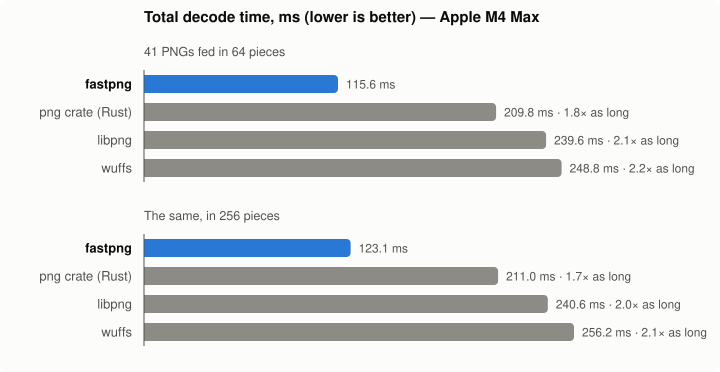

# fastpng: the world's fastest PNG decoder

(Probably. On an Apple M4 Max, against the decoders below.)

`fastpng.c` is a complete PNG decoder in one C file, about 2,300 lines with comments, with a
small API in `fastpng.h`. It decodes every PNG type (all color types and bit depths, palettes, tRNS
transparency, Adam7 interlacing) to 8-bit RGBA or BGRA, in one step or incrementally as the file
arrives. It's a port of the decoder
in SerenityOS's LibGfx and LibCompress, which grew these techniques while chasing PDF rendering
speed.

```
make && ./demo image.png -n 10 -o out.pam [--pieces N] [--check-crc] [--check-adler32] [--max-pixels N]
```

```c
#include "fastpng.h"
uint32_t w, h;
int error;
uint8_t* rgba = fastpng_decode_alloc(png_bytes, png_size, FASTPNG_RGBA, NULL, &w, &h, &error);
// Or verify every chunk's CRC and the zlib Adler-32 (about 8% slower), and allow up to 1 gigapixel
// (the default limit is 2^28 pixels, about 268 megapixels):
fastpng_options const options = { FASTPNG_CHECK_ALL, 1000000000 };
uint8_t* checked = fastpng_decode_alloc(png_bytes, png_size, FASTPNG_RGBA, &options, &w, &h, &error);
```

Decoding as the file arrives, for progressive rendering (each update gets all of it received so
far):

```c
// Interlaced images show a coarse version early, sharper with each pass.
fastpng_options const options = { FASTPNG_FILL_INTERLACE_PASSES, 0 };
fastpng_decoder* decoder = fastpng_decoder_create(&options);
// Once the first 33 bytes are there: fastpng_get_size(received, received_size, NULL, &w, &h),
// and allocate w * h * 4 bytes of pixels. Then, each time more data arrives:
fastpng_progress progress;
int status = fastpng_decoder_update(decoder, received, received_size, all_received, FASTPNG_RGBA, pixels, w * 4, &progress);
// FASTPNG_NEED_MORE_DATA: draw rows 0 to progress.rows_shown - 1; FASTPNG_OK: done.
fastpng_decoder_destroy(decoder);
```

## Speed


Total ms over 41 public PNGs chosen to be representative of the web and of documents (screenshots,
photos, maps, charts, sprites, icons, scans, PDF page renders; every color type, bit depths 1 to 16,
interlaced and not; see `bench/CORPUS.md`), best of 9 runs each, into freshly allocated output
(which each decode faults in; see `bench/run.sh`). Apple M4 Max, clang -O2 for fastpng, -O3 for the
C and C++ decoders, release + LTO for the png crate. fpng only decodes files fpng wrote, so the
second column is the same images re-encoded by fpng:

| decoder | checksums checked | 41 PNGs, ms | fastpng's time / theirs | fpng-written copies, ms | fastpng's time / theirs |
|---|---|---|---|---|---|
| **fastpng** | none | **113.8** | 1.00 | **136.9** | 1.00 |
| fastpng | CRC + Adler-32 | 122.1 | 0.93 | 152.0 | 0.90 |
| Blend2D | none | 161.9 (40 files: no 16-bit) | 0.69 | 167.0 | 0.82 |
| png crate (Rust; what Chromium uses) | CRC | 191.9 | 0.59 | 351.5 | 0.39 |
| png crate | none | 189.5 | 0.60 | 346.6 | 0.39 |
| libpng | CRC + Adler-32 | 242.4 | 0.47 | 254.2 | 0.54 |
| wuffs | CRC + Adler-32 | 252.3 | 0.45 | 334.2 | 0.41 |
| wuffs | none | 245.3 | 0.46 | 323.9 | 0.42 |
| stb_image | none | 305.9 | 0.37 | 416.5 | 0.33 |
| lodepng | CRC + Adler-32 | 421.2 | 0.27 | 531.9 | 0.26 |
| fpng | small chunks' CRCs | can't decode | | 177.8 | 0.77 |

With checksums checked, pixels and errors match wuffs' on PngSuite and the 41 images (217 files),
and on wuffs' test data and SerenityOS's PNG tests. Unchecked, the only difference is PngSuite's two
files with deliberately broken checksums, which fastpng then decodes.

What's checked affects speed, so the table says it: by default fastpng checks no CRCs and not
the zlib Adler-32 (`FASTPNG_CHECK_CRC` and `FASTPNG_CHECK_ADLER32` turn them on), and the png
crate by default checks chunk CRCs but not the Adler-32. Compare rows that check the same.

libpng here is Homebrew's (1.6.58, with its NEON filters), which inflates with macOS's system zlib.
Apple's zlib is 2-5x faster than stock zlib at inflating, which is most of libpng's time on dense
images. Built against stock zlib 1.3.1, the same libpng takes 393.2 ms instead of 243.3 (in a run of
its own), and wuffs is then 1.6x as fast as libpng, close to what it claims. Elsewhere, expect
libpng's numbers to look like that.

[Blend2D](https://blend2d.com/blog/png-image-codec.html)'s decoder (v0.21.3) claims about twice
libpng's and wuffs' speed, measured on x86 with AVX2. Here it's about 1.5x as fast as both, and
fastpng takes 0.69x its time. On ARM, Blend2D's inflate runs its portable 64-bit fast loop (its AVX2
loop is x86-only), with NEON unfiltering, and it's built as its CMake release build does (-O2,
static, no JIT). It decodes to its own formats: premultiplied BGRA (BGRX for opaque images), so its
time includes premultiplying, which a compositor wants anyway, and its pixels are compared with
wuffs' premultiplied, give or take 1 for rounding. It checks no checksums, and doesn't check that
palette indices are within the palette (fastpng does). It can't decode 16-bit images, ignores tRNS
on RGB images, and gets Adam7's pass 6 wrong in small 2- and 4-bit palette images (PngSuite's
`s0?i3p0?` and `s37i3p04`); the corpus has none of those but the 16-bit photo.

Where the png crate's time goes, on the 1600x1600 Paeth-filtered mandrill (21.1 ms vs fastpng's
9.6): inflate (fdeflate) about 7.6 ms, the same as fastpng's 7.5; unfiltering one row at a time
about 8.9 ms against fastpng's 1.4 eight rows at a time; and copying between its streaming buffers
about 3.3 ms.

## Incremental speed



The same 41 images, fed in 64 equal pieces (and 256) to the decoders that can resume, each picking
up where it stopped and showing what it can along the way: libpng's
progressive reader (rows combined with its "blocky" interlace display), the png crate's reader row
by row with interlace passes splatted over their blocks (the way Chromium uses it), wuffs'
suspending decoder, and fastpng's incremental decoder with `FASTPNG_FILL_INTERLACE_PASSES`:

| decoder | checksums checked | 64 pieces, ms | fastpng's time / theirs | 256 pieces, ms | fastpng's time / theirs |
|---|---|---|---|---|---|
| **fastpng** | none | **121.9** | 1.00 | **130.2** | 1.00 |
| png crate (Rust; what Chromium uses) | CRC | 215.4 | 0.57 | 216.7 | 0.60 |
| libpng | CRC + Adler-32 | 244.0 | 0.50 | 246.7 | 0.53 |
| wuffs | CRC + Adler-32 | 258.2 | 0.47 | 266.3 | 0.49 |

What each shows a quarter of the way through each file (`png-bench --incremental 8 --preview 2`;
pixels already at their final value, and PSNR of the whole partial image against the final one,
averaged over the 41 images):

| decoder | pixels final | PSNR | interlaced images |
|---|---|---|---|
| fastpng | 35.2% | 7.4 dB | coarse whole image, refined pass by pass |
| png crate | 35.2% | 7.4 dB | the same |
| libpng | 34.2% | 7.3 dB | the same, but nothing yet for one small image |
| wuffs | 11.3% | 5.1 dB | nothing until the image's data is all there |

fastpng shows exactly what the png crate does: every row whose data has arrived, and interlace
passes as blocks. wuffs inflates all of an image's data before unfiltering any of it, so it shows
nothing on the way. Resuming costs fastpng 7% over one-step decoding at 64 pieces and 14% at 256,
while the streaming decoders barely notice the piece count; it stays well ahead.

## The key ideas

The time goes to two places: inflating the zlib stream, and undoing the row filters. Everything
else (unpacking to RGBA) should ride along while the data is in cache.

**Inflate: libdeflate's design** (Eric Biggers):

- *Fat table entries.* A decode table entry carries everything about a symbol: whether it's a
  literal, a length or end-of-block, its value or base, and the number of bits to drop for the code
  *and* its extra bits together. A literal is one load, one shift, one store; one shift consumes a
  length code and its extra bits, and the extra bits are what was shifted out.
- *Branchless refill.* Load 8 bytes unaligned, OR them in above the bits held, advance the input by
  however many whole bytes fit. No loop, no branch. A refill guarantees 56 bits, which is budgeted
  so that up to three literals, or a literal and a whole match, decode between refills.
- *A fast loop with no bounds checks.* While the input and output are more than a margin from their
  ends, nothing is checked; a careful loop decodes the last few hundred bytes.
- *Overlapping word copies.* Matches copy 8 bytes at a time, writing past the match's end into the
  margin. Distance 1 broadcasts a byte.
- *Latency hiding.* The next table entry is loaded before the current match is copied.
- *Hot state in locals.* The fast loop works on local copies of the bit buffer and pointers, which
  stay in registers. Kept in a struct in memory, the same loop runs 2-3x slower.

**Inflate: beyond libdeflate.**

- *Two literals per table entry* (fpng's trick). When a literal's code is short enough that the
  next code also fits in the table's 11 bits, the entry holds both bytes. One lookup, one shift,
  one 2-byte store produce two bytes. Decoding literals is a serial lookup→shift→lookup chain, and
  this shortens it where literal codes are short. That's mostly fpng's own output (−23% decode
  cycles on fpng-written files). It also helps some smooth real-world images: 3 of the 19 bench
  PNGs got 16-18% faster, while the rest never pair, and PDF images (mostly matches) don't gain.
  Pairing a table costs as much as building it, so it's done only when the code lengths say a
  quarter or more of the entries pair, and paired blocks run their own copy of the fast loop.
  Single-literal blocks keep the 1-byte store and pay nothing.
- *Short-distance matches as vector repeats.* A match 2-7 bytes back reads bytes it's writing. Word
  copies then advance only 2-7 bytes each, every load waiting for the store before it: 3 bytes per
  step for a run of RGB pixels. For matches of 16+ bytes, the pattern is built once with a constant
  shuffle per distance, and 12-16 bytes are stored at a time with nothing to wait for.
- *No copy of a single IDAT chunk.* With one chunk, inflate reads it in place; several are joined
  first, which costs 1-2%.

**Unfiltering.** None and Up are trivially vectorized. Sub, Average and Paeth each predict a byte
from its left neighbour, so every row is a dependency chain across its pixels. The tricks shorten
the chain or run several at once:

- *Sub as a prefix sum.* A 16-byte vector adds itself shifted by 1, 2, 4… pixels (constant
  shuffles), then the previous vector's last pixel. That's one dependent add per 16 bytes, not per
  pixel. Each next vector is loaded *before* the current one is stored: with 3-byte pixels a vector
  holds 15 bytes, and a load overlapping the previous store would stall on store-to-load forwarding.
  Getting that wrong made it 30-65% slower than scalar.
- *Left pixel in registers.* Scalar Average and Paeth keep the left pixel in registers, not re-read
  from memory, with the per-channel loop unrolled for each pixel size.
- *A cheaper Paeth.* The scalar predictor uses stb_image's formulation (`3c - (a+b)` against min/max
  of a and b). It's equivalent to the spec on all 2^24 inputs, and puts fewer operations on the
  chain through `a`. The vector one is FPNGE's: everything in 8 bits with absolute differences and
  saturation, no widening.
- *Diagonal multi-row unfiltering* (from wuffs issue 157). A pixel needs the row above only up to
  one pixel to its right, so row r can work on pixel x−r while row 0 works on pixel x. Four rows of
  RGB or RGBA pixels fill one 16-byte vector, one pixel per row per lane group. Average and Paeth
  run four rows per step. Paeth, whose chain is long, runs eight rows in two vectors in about the
  time of four. Measured: about 2x for Average, 1.7-1.9x for 4-row Paeth, 3.1x for 8-row Paeth.
  Small pixels (1-3 bytes) run Average two rows at once.
- *No vector lanes through memory.* Kernel state lives in named vector variables, and lanes move
  between vectors by shuffles. Arrays of vectors and lane extraction compiled to stack round trips
  with store-forwarding stalls every step. Check the disassembly for `[sp` in hot loops.

**Unpacking.**

- *While it's in cache.* Rows are unfiltered in place in the inflated buffer 16 at a time, and each
  batch goes straight to the output. There's no second pass and no intermediate image.
- *One shuffle per 16 bytes.* RGB→RGBA puts four pixels in place, with alpha from an all-0xff
  vector. RGBA→BGRA is a byte swap shuffle, and RGBA→RGBA a memcpy. Gray and gray+alpha expand by
  shuffles too.
- *Tables of finished pixels.* Palettes and 1/2/4-bit grays go through 256-entry tables of output
  pixels. The tables already include tRNS alpha and the low-bit-depth scaling (1, 3, 15 → 255). The
  palette index check is per row, not per pixel.

**Checksums, when asked for.** Unasked, none of this code runs.

- *CRC-32 on the CPU's CRC32 instructions* (8 bytes each, about 12 GB/s here) where the target has
  them, through `__builtin_arm_crc32d` behind `__ARM_FEATURE_CRC32`; elsewhere slice-by-8 tables,
  built per decode instead of kept in a global.
- *Adler-32 in vectors, at about 28 GB/s.* Each 16 bytes add pairwise into four lanes of byte sums
  and into sixteen 16-bit column sums. The 16..1 weights apply to the column sums once per 4 KB
  block, not per byte: the weighted sum of every 16 bytes is the weighted sum of the columns.
- *Adler-32 while it's in cache.* It runs over each 16-row batch of inflated data just before that
  batch is unfiltered in place, which also has to come first since unfiltering changes the bytes.
- *Out of line on purpose.* Inlined into the row loop, the Adler-32 code slowed the unfiltering
  around it by half: checking cost 2x the decode time on some images instead of 1.2x.

**Portable SIMD without intrinsics.** All vector code uses GCC/clang vector extensions
(`vector_size`, element-wise operators, comparison masks, casts) and `__builtin_shufflevector` with
constant indices. Clang turns that into tbl/ext/uabd/uhadd/uqadd on NEON and pshufb/palignr on SSE.
Section 1 of `fastpng.c` has the handful of helpers; nothing is architecture-specific, except
the optional use of CRC32 instructions, with a portable fallback.

## Incremental decoding

A browser keeps a downloading image's bytes in memory anyway, so what matters is decoding what
has arrived and, when more arrives, going on from there instead of starting over: starting over
every time is quadratic in the image size. `fastpng_decoder_update()` takes all of the file so far
each time and decodes only what's new:

- *Inflate stops between symbols.* With more input possibly coming, it starts a block header or a
  symbol only when the longest possible one is all there, so it never uses the zero bits a refill
  makes up past the end, and saves where it stopped (bit position, block state, the current block's
  tables). The fast loop is unchanged.
- *Rows show as soon as their data is in.* Rows are unfiltered in place, but deflate matches copy
  from the last 32 KiB of output, which must still be the filtered bytes. So rows still in reach
  are unfiltered from copies in a small side buffer and unpacked right away; once inflate is past
  them, they're only added to the Adler-32 (when checked), and the last one shown, kept in the side
  buffer, is the row above the next. Each row is unfiltered once either way.
- *Block headers are read with what's there.* If a dynamic Huffman header (up to a few hundred
  bytes) turns out to need more input than has arrived, inflate goes back to the header's start and
  waits, instead of waiting for the largest possible header up front.
- *The file can be in pieces.* `fastpng_decoder_update_from()` reads the file through a callback
  that returns the bytes at a given offset, as many as are contiguous there (Chromium's
  `SegmentReader::GetSomeData()` has that shape), and `fastpng_decoder_update_spans()` takes a list
  of buffers instead. The decoder asks for few offsets, mostly at or just behind where it stopped,
  so through the callback an update's cost doesn't grow with how much of the file has arrived (a
  span list is walked each time). Chunks are found by their offset in the file, and the image data
  is inflated where it is, a piece at a time (an IDAT chunk's data within one buffer): each up to a
  few bytes from its end, then the bytes on either side of where it meets the next are copied
  together (at most 1 KiB, more than any block header) and inflated from the copy, and then on in
  place in the next. Several IDAT chunks aren't joined either. Big buffers wait until enough image
  data has arrived to plausibly fill them (deflate's 1032:1 bound again).
- *One-step decoding is the same code*, a single update with complete data. It got no slower:
  +0.4% cycles over the corpus, with the same instructions, and unchanged on small files.

- *Progressive display.* Each update reports `rows_final` (rows from the top that won't change),
  `rows_shown` (rows worth drawing now) and `passes_done`. A non-interlaced image comes in from the
  top. An interlaced one is final only at the end, but its point is to look like something sooner:
  with `FASTPNG_FILL_INTERLACE_PASSES`, each pass's pixels are spread over the block they stand for
  (8x8 after the first pass, then 4x8, 4x4, 2x4, 2x2, 1x2, and the last pass's single pixels), so
  the whole image shows coarse once the first pass is in, about 1/64 of its data, and sharpens pass
  by pass. Adam7's blocks only ever hold pixels of later passes, so filling never covers a decoded
  pixel, and the fill only runs while the image is incomplete.

Over the 41-image corpus, into an already allocated buffer, decoding in 64 pieces takes 9% longer
than in one step (17% in 256 pieces), and with the file in 4 KiB buffers, another 2% (3%); starting
over at every piece would take 32x (126x) as long. `bench/incremental.c` checks after every piece
that the rows reported final already have their final pixels, that an interlaced image's rows shown
match a preview worked out independently from the finished image (by passes done, or including the
pass under way), and at the end that the result is identical to one step, for random piece sizes
down to a byte at a time, in one buffer or in buffers of random sizes down to a byte, with and
without checksums checked. In a file with several problems, the error may name a different one than
a one-step decode would, having met them in another order.

## Limits and trade-offs

- Ignores gamma, chromaticities and ICC profiles (like wuffs and stb_image), and APNG animation (it
  decodes the default image). 16-bit samples keep their high byte.
- Holds the whole inflated image in memory: one buffer of height × (row bytes + 1), plus the
  output. A streaming decoder would use far less memory, at some speed. Images over
  `max_pixels` (by default 2^28, about 268 megapixels or 1 GiB of output) are rejected from the
  header, before anything big is allocated, so decoding needs at most about 3 GiB by default
  (plus a copy of the compressed data when it's split over several chunks). Image data also can't
  claim more than deflate's 1032:1 expansion of its size.
- Single-threaded by design.
- Needs clang, or gcc 12+ (gcc's build is ~15% slower), and a little-endian CPU. Tested on arm64
  (correctness and fuzzing, clang and gcc) and on wasm32 with SIMD under wasmtime (byte-identical
  output). It also builds for x86-64, but hasn't been run there.

## Files

- `fastpng.h`, `fastpng.c`: the decoder. `fastpng.c` sections:
  1. portable SIMD
  2. inflate
  3. checksums
  4. unfiltering
  5. unpacking
  6. the PNG container and API
- `demo.c`: decodes a file, in one step or in pieces (`--pieces N`, printing the progress after
  each: rows final, rows shown, passes done), prints the time, optionally writes a PAM and checks
  checksums.
- `bench/`: the comparison, independent of the rest.
  - `run.sh` reproduces the table: it builds everything, downloads the images listed in
    `images.txt` into `bench/build/images/` once (checking their SHA-256s), and runs the benchmark
    on them as written and re-encoded by fpng. With `PNGSUITE=dir` it first runs `--check` on
    PngSuite. Extra arguments go to png-bench, e.g. `bench/run.sh --only fastpng,png-rs`.
  - `CORPUS.md` says what's in the image set and why.
  - `build.sh` builds `bench/build/png-bench` against checkouts of wuffs, stb, fpng (which also
    provides lodepng) and libpng; paths are set with `WUFFS=`, `STB=`, `FPNG=`, `LIBPNG=`. With
    cargo around, it also builds `rust-png/`, a C-callable wrapper around the png crate (the
    columns `png-rs`, with the crate's default checks, and `png-rs-nc`, without). With a Blend2D
    checkout (`BLEND2D=`, default `~/src/blend2d`) and cmake, it builds that too (the `blend2d`
    column).
  - `build/png-bench -n 9 *.png` prints a table with a column per decoder.
  - `--incremental N` decodes each file fed in N pieces, with the decoders that can resume; with
    `--preview K` it stops them after K pieces and compares what each shows with the final image
    (`--preview-dir DIR` writes those partial images as PAM files).
  - `--fpng-reencode` benchmarks fpng-encoded copies.
  - `--check` compares fastpng's pixels and errors against wuffs' file by file, with checksums
    checked, and checks that unchecked decoding gives the same pixels.
  - `--only fastpng,wuffs` limits the columns (the last row, against fastpng, needs fastpng).
  - `--profile blend2d --seconds 5 file.png` decodes the files with just that decoder, over and
    over, for a profiler such as `sample` to watch.
  - `make_chart.py` regenerates `speed.svg` and `incremental.svg` from the totals written into it:
    `uv run bench/make_chart.py`.
  - `incremental.c` tests and times incremental decoding against one step, against the file in
    4 KiB buffers, and against starting over at every piece: `clang -O2 -I.. incremental.c ../fastpng.c -o build/incremental`, then
    `build/incremental -p 64 build/images/*.png`.
  - `fuzz.c` is a mutation fuzzer (also a libFuzzer target) that runs under ASan/UBSan. It checks
    that corrupt files fail cleanly in every checksum mode, that BGRA is RGBA swapped, that a
    file that decodes with checksums decodes the same without, and that decoding in random pieces
    (in one buffer or several) gives the same result as in one step. Its first run caught an
    allocation sized from a corrupt header, now rejected using the 1032:1 deflate bound.

## Credits

These ideas come from:

- libdeflate (Eric Biggers): the inflate design.
- wuffs (Nigel Tao): its "fastest, safest PNG decoder" write-up and issue 157.
- fpng (Rich Geldreich): literal pairs.
- FPNGE (Luca Versari, Zoltan Szabadka): 8-bit vector Paeth.
- stb_image (Sean Barrett): the scalar Paeth.
- The optidash "missing SIMD code" post.

The code was written for SerenityOS and ported here.
