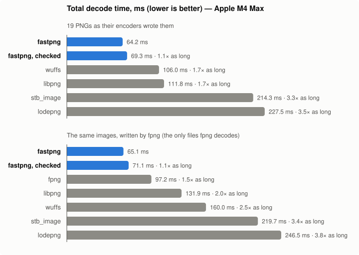

# fastpng: the world's fastest PNG decoder

(Probably. On an Apple M4 Max, against the decoders below.)

`fastpng.c` is a complete PNG decoder in one C file, about 1,800 lines with comments, with a
four-function API in `fastpng.h`. It decodes every PNG type (all color types and bit depths,
palettes, tRNS transparency, Adam7 interlacing) to 8-bit RGBA or BGRA. It's a port of the decoder
in SerenityOS's LibGfx and LibCompress, which grew these techniques while chasing PDF rendering
speed.

```
make && ./demo image.png -n 10 -o out.pam
```

```c
#include "fastpng.h"
uint32_t w, h;
int error;
uint8_t* rgba = fastpng_decode_alloc(png_bytes, png_size, FASTPNG_RGBA, &w, &h, &error);
```

## Speed



Total ms over 19 PNGs (wuffs' test images plus 14 large real-world PNGs; best of 9 runs each, into
freshly allocated output), Apple M4 Max, clang -O2 for fastpng, -O3 for the others:

| | fastpng | wuffs | wuffs, no checksums | libpng | stb_image | lodepng |
|---|---|---|---|---|---|---|
| total ms | **64.0** | 105.5 | 101.4 | 111.0 | 215.3 | 230.9 |
| fastpng's time / theirs | 1.00 | 0.61 | 0.63 | 0.58 | 0.30 | 0.28 |

fpng only decodes files fpng wrote, so its comparison is on those images re-encoded by fpng:

| | fastpng | fpng | wuffs | libpng | stb_image | lodepng |
|---|---|---|---|---|---|---|
| total ms | **66.3** | 98.1 | 164.7 | 131.3 | 219.8 | 245.5 |
| fastpng's time / theirs | 1.00 | 0.68 | 0.40 | 0.50 | 0.30 | 0.27 |

Pixels match wuffs' on PngSuite, wuffs' test data and the images above, except PngSuite's two
files with deliberately broken checksums, which wuffs rejects and fastpng (not checking
checksums) decodes.

What's checked, since it affects speed: fastpng checks no CRCs and not the zlib Adler-32. fpng
checks CRCs on the small chunks only (not IDAT) and no Adler-32; stb_image checks neither; wuffs
("no checksums" column aside), libpng and lodepng check both.

## The key ideas

The time goes to two places: inflating the zlib stream, and undoing the row filters. Everything
else (unpacking to RGBA) should ride along while the data is in cache.

**Inflate: libdeflate's design** (Eric Biggers):

- *Fat table entries.* A decode table entry carries everything about a symbol: whether it's a
  literal, a length or end-of-block, its value or base, and the number of bits to drop for the code
  *and* its extra bits together. A literal is one load, one shift, one store; one shift consumes a
  length code and its extra bits, and the extra bits are what was shifted out.
- *Branchless refill.* Load 8 bytes unaligned, OR them in above the bits held, advance the input by
  however many whole bytes fit. No loop, no branch. A refill guarantees 56 bits, which is budgeted
  so that up to three literals, or a literal and a whole match, decode between refills.
- *A fast loop with no bounds checks.* While the input and output are more than a margin from their
  ends, nothing is checked; a careful loop decodes the last few hundred bytes.
- *Overlapping word copies.* Matches copy 8 bytes at a time, writing past the match's end into the
  margin. Distance 1 broadcasts a byte.
- *Latency hiding.* The next table entry is loaded before the current match is copied.
- *Hot state in locals.* The fast loop works on local copies of the bit buffer and pointers, which
  stay in registers. Kept in a struct in memory, the same loop runs 2-3x slower.

**Inflate: beyond libdeflate.**

- *Two literals per table entry* (fpng's trick). When a literal's code is short enough that the
  next code also fits in the table's 11 bits, the entry holds both bytes. One lookup, one shift,
  one 2-byte store produce two bytes. Decoding literals is a serial lookup→shift→lookup chain, and
  this shortens it where literal codes are short. That's mostly fpng's own output (−23% decode
  cycles on fpng-written files). It also helps some smooth real-world images: 3 of the 19 bench
  PNGs got 16-18% faster, while the rest never pair, and PDF images (mostly matches) don't gain.
  Pairing a table costs as much as building it, so it's done only when the code lengths say a
  quarter or more of the entries pair, and paired blocks run their own copy of the fast loop.
  Single-literal blocks keep the 1-byte store and pay nothing.
- *Short-distance matches as vector repeats.* A match 2-7 bytes back reads bytes it's writing. Word
  copies then advance only 2-7 bytes each, every load waiting for the store before it: 3 bytes per
  step for a run of RGB pixels. For matches of 16+ bytes, the pattern is built once with a constant
  shuffle per distance, and 12-16 bytes are stored at a time with nothing to wait for.
- *No copy of a single IDAT chunk.* With one chunk, inflate reads it in place; several are joined
  first, which costs 1-2%.

**Unfiltering.** None and Up are trivially vectorized. Sub, Average and Paeth each predict a byte
from its left neighbour, so every row is a dependency chain across its pixels. The tricks shorten
the chain or run several at once:

- *Sub as a prefix sum.* A 16-byte vector adds itself shifted by 1, 2, 4… pixels (constant
  shuffles), then the previous vector's last pixel. That's one dependent add per 16 bytes, not per
  pixel. Each next vector is loaded *before* the current one is stored: with 3-byte pixels a vector
  holds 15 bytes, and a load overlapping the previous store would stall on store-to-load forwarding.
  Getting that wrong made it 30-65% slower than scalar.
- *Left pixel in registers.* Scalar Average and Paeth keep the left pixel in registers, not re-read
  from memory, with the per-channel loop unrolled for each pixel size.
- *A cheaper Paeth.* The scalar predictor uses stb_image's formulation (`3c - (a+b)` against min/max
  of a and b). It's equivalent to the spec on all 2^24 inputs, and puts fewer operations on the
  chain through `a`. The vector one is FPNGE's: everything in 8 bits with absolute differences and
  saturation, no widening.
- *Diagonal multi-row unfiltering* (from wuffs issue 157). A pixel needs the row above only up to
  one pixel to its right, so row r can work on pixel x−r while row 0 works on pixel x. Four rows of
  RGB or RGBA pixels fill one 16-byte vector, one pixel per row per lane group. Average and Paeth
  run four rows per step. Paeth, whose chain is long, runs eight rows in two vectors in about the
  time of four. Measured: about 2x for Average, 1.7-1.9x for 4-row Paeth, 3.1x for 8-row Paeth.
  Small pixels (1-3 bytes) run Average two rows at once.
- *No vector lanes through memory.* Kernel state lives in named vector variables, and lanes move
  between vectors by shuffles. Arrays of vectors and lane extraction compiled to stack round trips
  with store-forwarding stalls every step. Check the disassembly for `[sp` in hot loops.

**Unpacking.**

- *While it's in cache.* Rows are unfiltered in place in the inflated buffer 16 at a time, and each
  batch goes straight to the output. There's no second pass and no intermediate image.
- *One shuffle per 16 bytes.* RGB→RGBA puts four pixels in place, with alpha from an all-0xff
  vector. RGBA→BGRA is a byte swap shuffle, and RGBA→RGBA a memcpy. Gray and gray+alpha expand by
  shuffles too.
- *Tables of finished pixels.* Palettes and 1/2/4-bit grays go through 256-entry tables of output
  pixels. The tables already include tRNS alpha and the low-bit-depth scaling (1, 3, 15 → 255). The
  palette index check is per row, not per pixel.

**Portable SIMD without intrinsics.** All vector code uses GCC/clang vector extensions
(`vector_size`, element-wise operators, comparison masks, casts) and `__builtin_shufflevector` with
constant indices. Clang turns that into tbl/ext/uabd/uhadd/uqadd on NEON and pshufb/palignr on SSE.
Section 1 of `fastpng.c` has the handful of helpers; nothing is architecture-specific.

## Limits and trade-offs

- Ignores gamma, chromaticities and ICC profiles (like wuffs and stb_image), and APNG animation (it
  decodes the default image). 16-bit samples keep their high byte.
- Holds the whole inflated image in memory: one buffer of height × (row bytes + 1), plus the
  output. A streaming decoder would use far less memory, at some speed.
- Single-threaded by design.
- Needs clang, or gcc 12+ (gcc's build is ~15% slower), and a little-endian CPU. Tested on arm64
  (correctness and fuzzing, clang and gcc). It also builds for x86-64, but hasn't been run there.

## Files

- `fastpng.h`, `fastpng.c`: the decoder. `fastpng.c` sections:
  1. portable SIMD
  2. inflate
  3. unfiltering
  4. unpacking
  5. the PNG container and API
- `demo.c`: decodes a file, prints the time, optionally writes a PAM.
- `bench/`: the comparison, independent of the rest.
  - `build.sh` builds `bench/build/png-bench` against checkouts of wuffs, stb, fpng (which also
    provides lodepng) and libpng. Paths are set with `WUFFS=`, `STB=`, `FPNG=`, `LIBPNG=`.
  - `build/png-bench -n 9 *.png` prints a table like the ones above.
  - `--fpng-reencode` benchmarks fpng-encoded copies.
  - `--check` compares fastpng's pixels against wuffs' file by file.
  - `--only fastpng,wuffs` limits the columns.
  - `make_chart.py` regenerates `speed.svg` from the totals written into it:
    `uv run bench/make_chart.py`.
  - `fuzz.c` is a mutation fuzzer (also a libFuzzer target) that runs under ASan/UBSan. It checks
    that corrupt files fail cleanly and that BGRA is RGBA swapped. Its first run caught an
    allocation sized from a corrupt header, now rejected using the 1032:1 deflate bound.

## Credits

These ideas come from:

- libdeflate (Eric Biggers): the inflate design.
- wuffs (Nigel Tao): its "fastest, safest PNG decoder" write-up and issue 157.
- fpng (Rich Geldreich): literal pairs.
- FPNGE (Luca Versari, Zoltan Szabadka): 8-bit vector Paeth.
- stb_image (Sean Barrett): the scalar Paeth.
- The optidash "missing SIMD code" post.

The code was written for SerenityOS and ported here.
